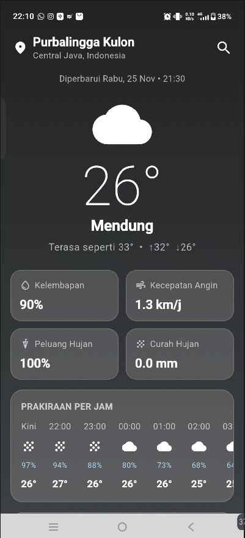
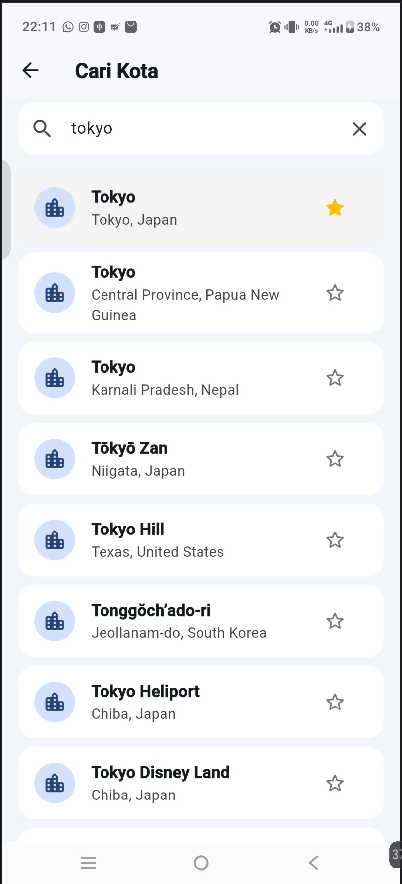
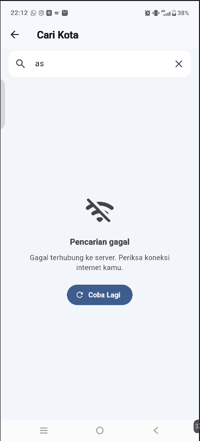
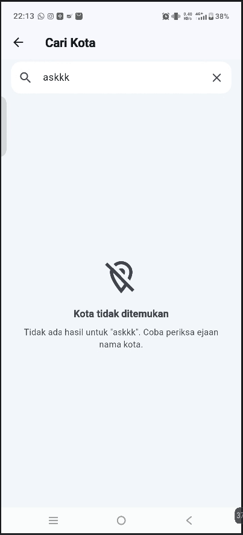

# Cuaca App — Responsi Flutter

Aplikasi mobile prakiraan cuaca berbasis **Flutter** yang mengambil data secara langsung dari **Open-Meteo API**, dibangun dengan arsitektur **MVVM** (Model–View–ViewModel), state management **Provider**, dan local storage **Hive**.

|               |                             |
|---------------|-----------------------------|
| **Nama**      | _Mohammad Ferdian Samputra_ |
| **NIM**       | _H1D024023_                 |
| **Shift KRS** | _F_                         |

---

## Daftar Isi
1. [Fitur](#fitur)
2. [Screenshot](#screenshot)
3. [Teknologi](#teknologi)
4. [Struktur Aplikasi](#struktur-aplikasi)
5. [Penerapan MVVM](#penerapan-mvvm)
6. [Implementasi API](#implementasi-api)
7. [Local Storage](#local-storage)
8. [Penanganan State](#penanganan-state)
9. [Cara Menjalankan](#cara-menjalankan)

---

## Fitur

### Home / Weather Screen
- Nama kota beserta provinsi dan negara
- Ikon dan deskripsi kondisi cuaca (bahasa Indonesia, dari kode cuaca WMO)
- Suhu saat ini, suhu yang dirasakan, serta suhu maksimum/minimum hari ini
- Info tambahan: kelembapan, kecepatan angin, peluang hujan, dan curah hujan
- Prakiraan per jam untuk 24 jam ke depan
- Prakiraan harian untuk 7 hari
- Jam matahari terbit/terbenam dan indeks UV
- Latar gradien yang berubah mengikuti kondisi cuaca dan siang/malam
- Tarik ke bawah (*pull-to-refresh*) untuk memuat ulang data

### Search / Location Screen
- Pencarian kota melalui **Open-Meteo Geocoding API** (otomatis 0,5 detik setelah berhenti mengetik)
- Menyimpan dan menghapus **kota favorit** (ikon bintang)
- **Riwayat pencarian** (maksimal 10 kota, tanpa duplikat) beserta tombol hapus
- Memilih kota akan langsung memperbarui cuaca di Home

### Lainnya
- Kota default **Purwokerto** saat aplikasi pertama kali dibuka; selanjutnya membuka kota terakhir yang dilihat
- Tampilan loading, error (dengan tombol "Coba Lagi"), dan data kosong
- Layout responsif (grid info 2 kolom di HP, 4 kolom di layar lebar; lebar konten dibatasi di tablet)

---

## Screenshot

> Simpan screenshot di folder `screenshots/` dengan nama file sesuai tabel di bawah.

|                    Home                    |                Search Screen                 |
|:------------------------------------------:|:--------------------------------------------:|
|  |  |

|               Error Internet               |          Kota Tidak Ditemukan          |
|:------------------------------------------:|:--------------------------------------:|
|  |  |

---

## Teknologi

| Package | Kegunaan |
|---|---|
| [`provider`](https://pub.dev/packages/provider) | State management; `ChangeNotifier` sebagai ViewModel |
| [`open_meteo`](https://pub.dev/packages/open_meteo) | Request ke Open-Meteo Weather Forecast API & Geocoding API |
| [`hive_ce`](https://pub.dev/packages/hive_ce), [`hive_ce_flutter`](https://pub.dev/packages/hive_ce_flutter) | Local storage favorit, riwayat, dan lokasi terakhir |

Dikembangkan dengan Flutter 3.47.7 dan Dart 3.13.5.

---

## Struktur Aplikasi

```
lib/
├── main.dart                         # Entry point: inisialisasi Hive & Provider
├── core/                             # Helper yang dipakai bersama
│   ├── app_theme.dart                #   Theme & typography (Material 3)
│   ├── formatters.dart               #   Format tanggal, jam, suhu (bahasa Indonesia)
│   └── weather_code.dart             #   Kode WMO -> deskripsi, ikon, warna gradien
├── models/                           # MODEL
│   ├── location_model.dart           #   Data kota (Geocoding API)
│   └── weather_model.dart            #   Data cuaca: current, hourly, daily (Forecast API)
├── services/                         # Sumber data
│   ├── weather_api_service.dart      #   Request ke Open-Meteo API
│   └── local_storage_service.dart    #   Baca/tulis Hive
├── viewmodels/                       # VIEWMODEL
│   ├── view_state.dart               #   Enum status: idle, loading, success, empty, error
│   ├── weather_viewmodel.dart        #   State & logika Home Screen
│   └── search_viewmodel.dart         #   State & logika Search Screen
└── views/                            # VIEW
    ├── home_screen.dart              #   Home / Weather Screen
    ├── search_screen.dart            #   Search / Location Screen
    └── widgets/                      #   Komponen UI yang dapat dipakai ulang
        ├── current_weather_section.dart
        ├── forecast_sections.dart    #   Prakiraan per jam, 7 hari, matahari
        ├── glass_card.dart
        ├── info_grid.dart
        └── state_views.dart          #   Tampilan loading / error / kosong
test/
└── widget_test.dart                  # Unit test parsing JSON -> model
```

---

## Penerapan MVVM

```
┌────────────┐  aksi user   ┌──────────────┐  panggil    ┌─────────────┐  HTTP GET  ┌────────────┐
│    VIEW    │ ───────────► │  VIEWMODEL   │ ──────────► │   SERVICE   │ ─────────► │ Open-Meteo │
│ (Widget)   │              │ (ChangeNotif)│             │ (API, Hive) │ ◄───────── │    API     │
│            │ ◄─────────── │              │ ◄────────── │             │    JSON    └────────────┘
└────────────┘ notifyListen └──────────────┘    MODEL    └─────────────┘
```

| Lapisan | File | Tanggung jawab |
|---|---|---|
| **Model** | `models/` | Representasi data. `fromJson()` mengubah JSON dari API menjadi objek Dart; `toJson()` mengubah objek menjadi Map untuk disimpan ke Hive. |
| **View** | `views/` | Hanya menampilkan UI dan meneruskan aksi user ke ViewModel. View **tidak pernah** memanggil API atau Hive secara langsung. |
| **ViewModel** | `viewmodels/` | Menyimpan state (data, status loading/error), menjalankan logika, dan memanggil Service. Setiap perubahan state diumumkan lewat `notifyListeners()`. |
| **Service** | `services/` | Lapisan akses data: networking ke Open-Meteo dan penyimpanan lokal Hive. |

**Penghubung View ↔ ViewModel (Provider):**
- `main.dart` mendaftarkan `WeatherViewModel` dan `SearchViewModel` dengan `MultiProvider` + `ChangeNotifierProvider`.
- View membaca state dengan `context.watch<...>()` sehingga otomatis di-build ulang ketika ViewModel memanggil `notifyListeners()`.
- View memicu aksi dengan `context.read<...>()`, misalnya `selectLocation()` atau `toggleFavorite()`.

**StatelessWidget vs StatefulWidget:**
- `HomeScreen` memakai **StatelessWidget** karena seluruh state-nya disimpan di `WeatherViewModel`.
- `SearchScreen` memakai **StatefulWidget** karena membutuhkan `TextEditingController` yang harus dibuat di `initState()` dan dibuang di `dispose()`.

**Contoh alur: memilih kota**
1. User mengetik nama kota → `SearchViewModel.onQueryChanged()` (debounce 500 ms) → `search()`.
2. `WeatherApiService.searchLocations()` mengirim request ke Geocoding API → JSON diubah menjadi `List<LocationModel>`.
3. User mengetuk sebuah kota → `addToHistory()` (disimpan ke Hive) dan `WeatherViewModel.selectLocation()`.
4. `loadWeather()` memanggil `fetchWeather()` → JSON diubah menjadi `WeatherModel` → `notifyListeners()` → Home menampilkan data baru.

---

## Implementasi API

Semua request dilakukan di `lib/services/weather_api_service.dart` menggunakan package `open_meteo`. Method `requestJson()` mengirim **HTTP GET** dan mengembalikan respons dalam format **JSON** (`Map<String, dynamic>`), yang kemudian diubah menjadi model Dart.

### 1. Weather Forecast API
`GET https://api.open-meteo.com/v1/forecast`

| Parameter | Nilai |
|---|---|
| `latitude`, `longitude` | Koordinat kota terpilih |
| `current` | `temperature_2m`, `relative_humidity_2m`, `apparent_temperature`, `precipitation`, `weather_code`, `wind_speed_10m`, `is_day` |
| `hourly` | `temperature_2m`, `weather_code`, `precipitation_probability`, `is_day` |
| `daily` | `weather_code`, `temperature_2m_max`, `temperature_2m_min`, `precipitation_probability_max`, `sunrise`, `sunset`, `uv_index_max` |
| `forecast_days` | `7` |
| `timezone` | `auto` (zona waktu mengikuti lokasi) |

Respons diparsing oleh `WeatherModel.fromJson()`:
- Blok `current` → `CurrentWeather`
- Blok `hourly` → `List<HourlyForecast>` (disaring mulai jam sekarang, 24 jam)
- Blok `daily` → `List<DailyForecast>`

Waktu dari API berupa Unix timestamp, lalu dikonversi ke jam lokal kota menggunakan field `utc_offset_seconds`.

### 2. Geocoding API
`GET https://geocoding-api.open-meteo.com/v1/search?name=<kota>&count=15`

Setiap elemen dari array `results` diubah dengan `LocationModel.fromJson()`. Jika kota tidak ditemukan, key `results` tidak ada pada respons, sehingga aplikasi mengembalikan list kosong dan menampilkan pesan "Kota tidak ditemukan".

### Penanganan error
- Gagal koneksi (tidak ada internet / timeout) ditangkap dengan `try/catch`.
- Respons berisi `{"error": true, "reason": "..."}` dari server juga diperiksa.
- Keduanya dilempar sebagai `ApiException` berisi pesan bahasa Indonesia, lalu ditampilkan oleh ViewModel ke View.

---

## Local Storage

`lib/services/local_storage_service.dart` menggunakan satu box Hive (`cuaca_box`) dengan tiga key:

| Key | Isi |
|---|---|
| `favorites` | Daftar kota favorit |
| `history` | Riwayat kota yang pernah dipilih (maks. 10, tanpa duplikat, terbaru di atas) |
| `last_location` | Kota terakhir yang dilihat, dibuka kembali saat aplikasi dijalankan |

Data disimpan sebagai `List<Map>` hasil `LocationModel.toJson()`, sehingga tidak memerlukan TypeAdapter maupun code generation.

---

## Penanganan State

Kedua ViewModel memakai enum `ViewState`:

| Status | Tampilan |
|---|---|
| `idle` | Search: menampilkan daftar Favorit & Riwayat |
| `loading` | Indikator loading |
| `success` | Data ditampilkan |
| `empty` | Pesan data kosong / kota tidak ditemukan |
| `error` | Pesan error + tombol "Coba Lagi" (jika refresh gagal, data lama tetap tampil dengan banner error) |

Respons yang sudah usang diabaikan: `SearchViewModel` memakai penghitung `_requestId`, dan `WeatherViewModel` memeriksa apakah lokasi masih sama sebelum menyimpan hasil.

---

## Cara Menjalankan

```bash
# 1. Clone repository
git clone <url-repository-kamu>
cd cuaca_app

# 2. Install dependency
flutter pub get

# 3. Jalankan aplikasi (emulator / HP terhubung)
flutter run

# 4. (Opsional) Jalankan unit test
flutter test
```

> Untuk build APK release, pastikan `android/app/src/main/AndroidManifest.xml` memuat
> `<uses-permission android:name="android.permission.INTERNET"/>`.

---

Data cuaca disediakan oleh [Open-Meteo.com](https://open-meteo.com/) (CC BY 4.0).
